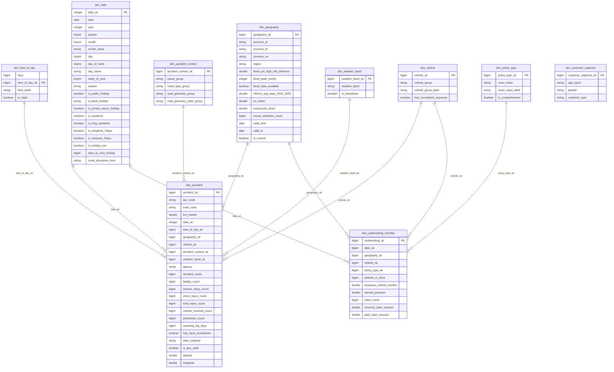

# Warehouse ER Diagram (CLAUDE.md §8)

Auto-generated by `scripts/generate_er_diagram.py` from the live
`warehouse.duckdb` schema -- regenerate after any dimension/fact change
rather than hand-editing.

Conformed dimensions `dim_date` and `dim_geography` are shared by both
facts (Kimball bus architecture) -- note both appear on the left of two
relationships below. `agency` is a degenerate attribute on `fact_accident`
(not shown as a relationship -- it has no dimension table, CLAUDE.md §8).

